# 奇妙萌可之闪耀流星 · M5Stack StopWatch 同人固件

**非官方同人作品。** 与 M5Stack、SAMG Entertainment、惊奇和睿均无隶属或授权关系。角色与商标归权利人所有，见 [NOTICE.md](NOTICE.md)。

Unofficial fan firmware for the M5Stack StopWatch (ESP32-S3, 466×466 round AMOLED). It keeps the official M5StopWatch-UserDemo BSP/HAL and Mooncake launcher, and adds voice-led 《奇妙萌可之闪耀流星》 apps for a child who cannot read yet. Not affiliated with M5Stack, SAMG Entertainment, or 惊奇和睿.

## 界面

下面是 QEMU 里的圆屏画面（466×466）。缩略图大约三列，点开是原图。文件在 `docs/screenshots/`。

<p align="center">
<a href="docs/screenshots/launcher.png">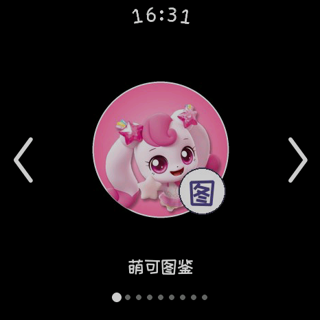</a>
<a href="docs/screenshots/carousel-aixin.png">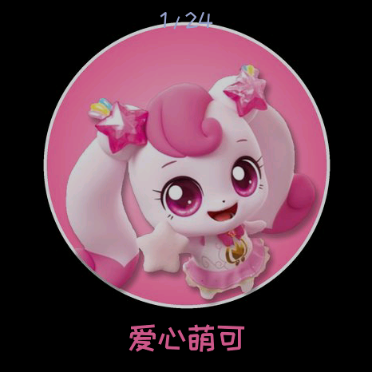</a>
<a href="docs/screenshots/carousel-info.png">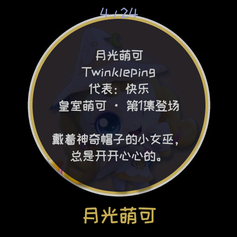</a>
<br>
<sub>启动器 · 萌可图鉴（爱心萌可） · 资料卡（月光萌可）</sub>
</p>

<p align="center">
<a href="docs/screenshots/draw-result.png">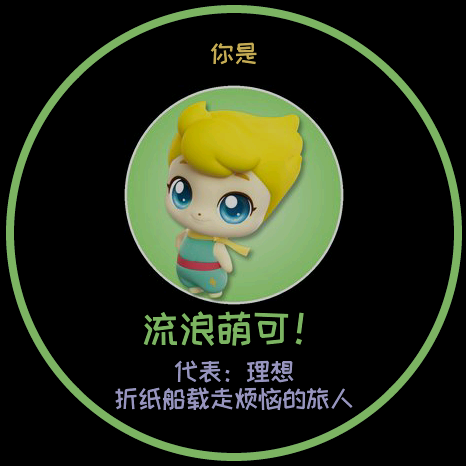</a>
<a href="docs/screenshots/watch-face.png">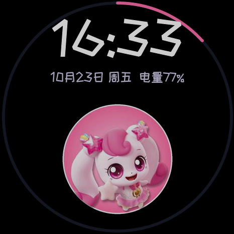</a>
<a href="docs/screenshots/quiz.png">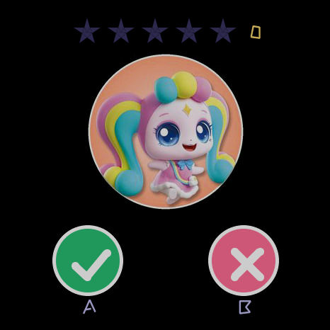</a>
<br>
<sub>你是哪只萌可 · 萌可表盘 · 萌可问答</sub>
</p>

<p align="center">
<a href="docs/screenshots/catch-search.png">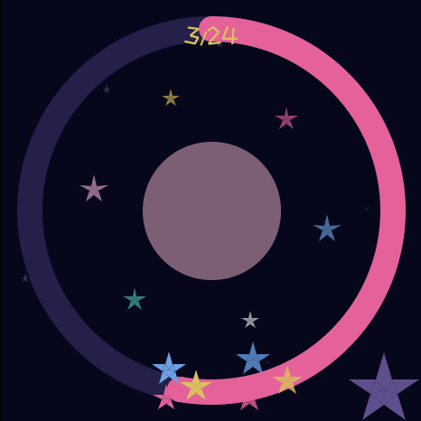</a>
<a href="docs/screenshots/catch-success.png">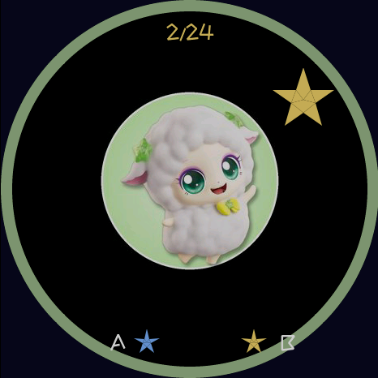</a>
<a href="docs/screenshots/catch-miss.png">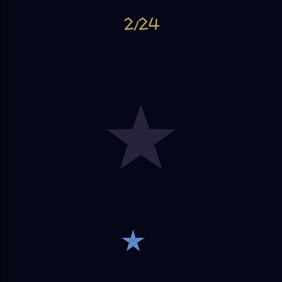</a>
<br>
<sub>捕捉萌可（努力中） · 抓到 · 跑掉</sub>
</p>

<p align="center">
<a href="docs/screenshots/transform.png">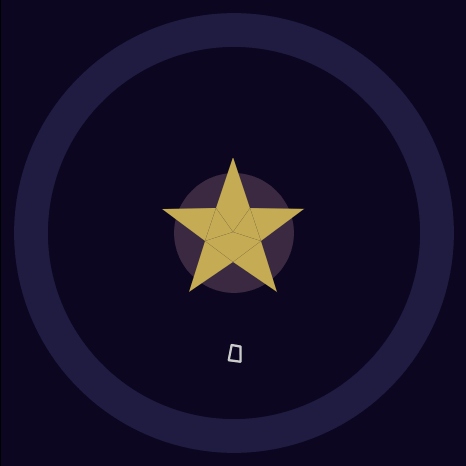</a>
<a href="docs/screenshots/memory.png"></a>
<a href="docs/screenshots/pet-select.png">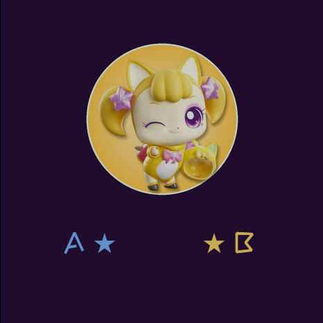</a>
<br>
<sub>萌可变身 · 萌可躲猫猫 · 养萌可</sub>
</p>

<p align="center">
<a href="docs/screenshots/settings.png">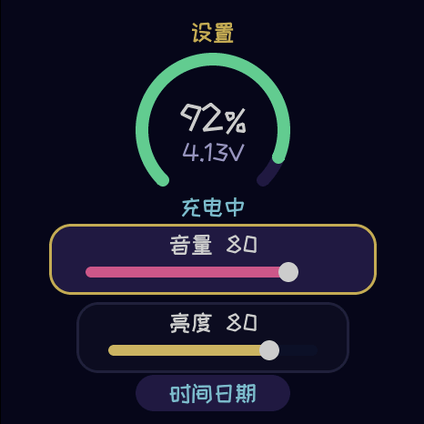</a>
<br>
<sub>设置</sub>
</p>

目标硬件：M5Stack StopWatch。主控 ESP32-S3，16 MB flash，8 MB OPI PSRAM，CO5300 圆形 AMOLED（466×466），BMI270 姿态传感器。工程基于官方 [M5StopWatch-UserDemo](https://github.com/m5stack/M5StopWatch-UserDemo) 的 BSP / HAL、显示、电源与按键处理，启动器为 Mooncake。固件版本字符串为 `V0.5`。

语音提示由 edge-tts（`zh-CN-XiaoyiNeural`）生成，再压成 16 kHz IMA-ADPCM，给还不会认字的小朋友听。应用里按住 A+B 回到启动器（官方 UserDemo 的回主页手势）。

## 应用

启动器顺序与 `main/main.cpp` 一致。源码都在 `main/apps/mengke/`。

1. **萌可图鉴**（`app_carousel.cpp`）  
     
   24 只萌可轮播。A / B 或左右滑动切换，并念出名字和一句介绍。点一下打开资料卡，长按收藏（♥，存在 NVS）。上次看到的一只会被记住。

2. **你是哪只萌可**（`app_draw.cpp`，摇一摇 / 老虎机抽取）  
     
   摇手表（BMI270）、按 A 或 B、或点屏幕，头像开始滚动，然后揭晓「你是 X 萌可！」并念介绍。

3. **萌可表盘**（`app_watch.cpp`）  
     
   时钟表盘：秒环、日期、星期、电量，旁边一只陪伴萌可。A / B 或滑动换陪伴（会保存）。点她一下，会念出现在的时间。

4. **萌可问答**（`app_quiz.cpp`）  
     
   给不识字的孩子听的是非题（「这是 X 萌可吗？」以及皇室 / 星星萌可）。A 或 ✓ 表示「是」，B 或 ✗ 表示「否」，点图片再听一遍。答对得一颗星（NVS）；答错先鼓励再想一次，第二次才公布答案。每 5 颗星有一次庆祝。

5. **捕捉萌可 / 抓萌可**（`app_catch.cpp`）  
       
   不看方向箭头，靠摇、转手表或连按 A 积攒进度环（大约持续用力 3–6 秒）。进度过程中有鼓励语音。满了之后大约 **70% 抓到**、**30% 跑掉**（`esp_random() % 10 < 7`），跑掉只说「再试一次」，不扣已有收藏。B 打开已抓到的图鉴（NVS `catch`）。

6. **萌可变身**（`app_transform.cpp`）  
     
   摇 / 转手表或按 A 给能量环充能，伴随闪光和上升音阶。充满后变出一只随机萌可，并念名字和介绍。能量不会往回掉，没有失败。

7. **萌可躲猫猫 / 萌可记忆**（`app_memory.cpp`）  
     
   牌面朝下的配对。翻开时她会说自己的名字；配对成功牌留下，配错则轻轻说「再找找看」并翻回去。过关得一颗星（和问答共用星星计数），关卡从 2 对加到 3 对、4 对（NVS `mpairs`）。A / B 听提示。

8. **养萌可 / 萌可养成**（`app_pet.cpp`）  
     
   选一只陪伴（A 下一只，B 或点按确定；长按她可以重选）。喂一喂（A）、摸摸、跳舞（B 之后再摇）。开心是 5 颗心，按 RTC 时间慢慢下降，最低 20，不会生病。连续每天来看会解锁蝴蝶结、皇冠、星星魔杖。

9. **设置**（`app_settings.cpp`）  
     
   电量百分比、电压、充电状态；音量 0–100；亮度 10–100。两者经官方 HAL 写入 NVS。A / B 对当前行 −/+10，也可以点行或拖滑条。底部「时间日期」复用了官方设置里的时间、日期页（原来的「系统」应用没有装进这个固件）。

启动器本身（Mooncake 图标页、状态栏、开机音效、充电提示）留着。官方示例里的秒表等应用没有注册进 `app_main`。

## 编译

需要 ESP-IDF **5.5.x**。`sdkconfig.defaults` 来自 ESP-IDF 5.5.4；`platformio.ini` 里的 pioarduino 55.03.312 对应 ESP-IDF 5.5.5。`./build.sh` 会 source `~/esp/esp-idf-5.5/export.sh`，请把 IDF 装在这个路径，或先自行 `export.sh` 再改脚本。

第三方组件**不在**仓库里，按 `repos.json` 拉取（Mooncake、LVGL、M5GFX、M5IOE1、M5PM1、BMI270 等）。本地组件 `components/m5emu` 随仓库提供，它是 QEMU / esp-emulator 垫片，**不在** `repos.json` 里。

```bash
python3 fetch_repos.py
# PlatformIO 预脚本是同一份依赖：scripts/fetch_components.py
./build.sh
```

`./build.sh` 执行 `idf.py -B build -DSDKCONFIG=build/sdkconfig build`，再用 esptool 把分区合并成 `release/mengke-stopwatch.bin`（`--fill-flash-size 16MB`）。

也可以用 PlatformIO：`platformio.ini` 的 `m5stack-stopwatch` 环境会在编译前跑 `scripts/fetch_components.py`。

## 烧录

合并后的镜像从 **0x0** 写入 **16 MB** flash：

```bash
python -m esptool --chip esp32s3 -p /dev/ttyACM0 -b 921600 \
    write_flash 0x0 release/mengke-stopwatch.bin
```

把串口换成自己的设备节点。分区表是 `partitions.csv`（NVS、phy、factory、coredump）。

## 重新生成资源

日常编译**不需要**这一步。`main/assets/mengke/` 里已经有生成好的 JPEG 头像、图标、ADPCM 语音和中文字体子集。

要重做素材：

```bash
python3 tools/gen_assets.py   # 圆角 JPEG + edge-tts → IMA-ADPCM + mengke_data
./tools/gen_fonts.sh          # 站酷快乐体子集（约用到界面里出现的汉字）
```

`tools/gen_assets.py` 从 `research/img/<英文名>.png` 读**官方角色原图**。这些 PNG **没有**放进本仓库，见 [research/MENGKE_SOURCES.md](research/MENGKE_SOURCES.md)。没有这批原图就不要跑生成脚本；已提交的 `main/assets/mengke/` 足够编译。

`tools/gen_fonts.sh` 还需要本机的 `lv_font_conv`，以及未随仓库提供的 `tools/fonts/ZCOOLKuaiLe-Regular.ttf`（站酷快乐体，OFL）。♥ / ★ 取自系统的 DejaVu Sans Bold。脚本还会调用 `edge-tts`、`ffmpeg` 和 Pillow。生成缓存在 `tools/cache/`（已忽略）。

## QEMU / 模拟器

两套东西，不要混在一起：

- **esp-emulator 垫片**：`components/m5emu`。根目录 `CMakeLists.txt` 在 `-DM5EMU=1`（或环境变量 `M5EMU`）时编进工程，并定义 `M5EMU_PORT=1`。额外默认值在 `sdkconfig.emu`。显示是 466×466 RGB565 帧缓冲，按键走 GPIO，IMU / RTC / 电量等由外部灌入。
- **本机 QEMU 脚本**：`tools/qemu_boot.sh`、`tools/qemu_test.py`、`tools/qmpc.py`。它们对着一份本地的 [M5StopWatch-QEMU](https://github.com/zqqf16/M5StopWatch-QEMU) 树说话。脚本里的路径目前写死为 `/workspace/m5stopwatch-qemu-oss`，固件路径是 `/workspace/mengke-fw/release/mengke-stopwatch.bin`。使用前改成你的 QEMU 检出目录，以及本仓库 `./build.sh` 生成的 `release/mengke-stopwatch.bin`。`qemu_test.py` 把当次测试截图写到仓库根目录的 `screenshots/`（已忽略）。README 用的示例图在 `docs/screenshots/`。

## 目录

| 路径 | 内容 |
| --- | --- |
| `main/apps/mengke/` | 上面 9 个萌可应用 |
| `main/apps/app_launcher/` | Mooncake 启动器 |
| `main/hal/` | 来自 UserDemo 的 BSP / HAL |
| `main/assets/mengke/` | 已生成的头像、字体、语音 |
| `components/m5emu/` | 仓库内的模拟器垫片 |
| `repos.json` / `fetch_repos.py` | 需要拉取的第三方组件 |
| `patches/` | 打在 M5IOE1、M5PM1 上的补丁 |
| `research/` | 角色核对记录和圆卡预览；`research/img/` 不含在仓库中 |
| `tools/` | 资源生成与 QEMU 辅助脚本 |
| `docs/screenshots/` | README 用的 QEMU 界面截图 |

## 许可

本仓库以 MIT 许可发布，Copyright (c) 2026 zqqf16，见 [LICENSE](LICENSE)。其中相当一部分代码来自 M5Stack M5StopWatch-UserDemo（MIT，Copyright M5Stack Technology CO LTD）。`repos.json` 拉下来的第三方组件各自保留原许可证。角色相关的权利声明见 [NOTICE.md](NOTICE.md)。
